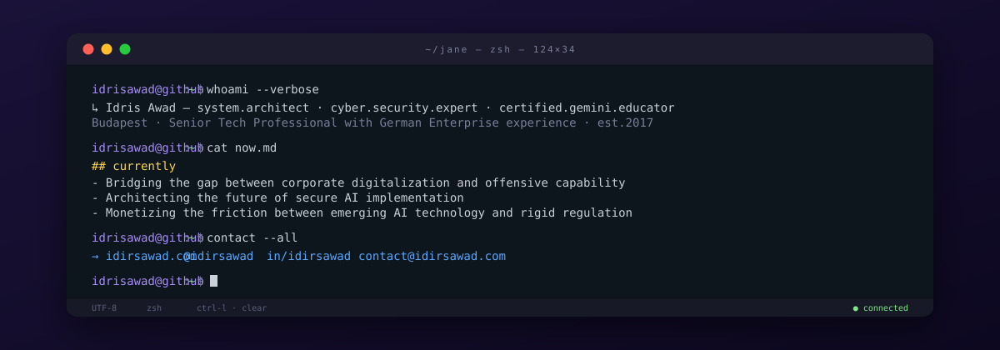

<table>
  <tr>
    <td>
      
    </td>
  </tr>
</table>

  

<table>
  <tr>
    <td>
      
    </td>
    <td>
      
    </td>
  </tr>
</table>

  My name is Idris Awad, I am a Senior Tech Professional with +5 years Swiss and German Enterprise experiencem in IT security, AI, WEB3, and Blockchain fields, with a passion for Coding, Creating, Breaking, and Fixing things.

  &nbsp;
  &nbsp;
  &nbsp;
  &nbsp;
  &nbsp;
  &nbsp;
  &nbsp;
  &nbsp;
  &nbsp;
  &nbsp;
  &nbsp;
  &nbsp;
  &nbsp;

---

  On this Repo, you will find a variety of projects related to IT security, AI, WEB3 and blockchain, as well as other projects that I find interesting and fun to work on. I invite you to take a look around, and feel free to reach out if you have any questions or want to collaborate on a project.

### 📊 Official Repo Stats - My Forked Stats 📊 ###

 

### Legal Disclaimer: ###

*The information provided on this GitHub page (the "Page") is for general informational purposes only. The Page is not intended to provide legal advice or create an attorney-client relationship. You should not act or rely on any information on the Page without seeking the advice of a qualified attorney. The developer(s) of this Page do not warrant or guarantee the accuracy, completeness, or usefulness of any information contained on the Page and will not be liable for any errors or omissions in the information provided or for any actions taken in reliance on the information provided.*

### Policy: ###

*All code and other materials provided on this Page are the property of the developer(s) and are protected by copyright and other intellectual property laws. You may not use, reproduce, distribute, or create derivative works from the code or materials on the Page without the express written consent of the developer(s). If you would like to use any of the code or materials provided on this Page for any purpose, please contact the developer(s) for permission.*

*The developer(s) reserve the right to make changes to the Page and to the code and materials provided on the Page at any time and without notice. The developer(s) also reserve the right to terminate access to the Page or to any code or materials provided on the Page at any time and without notice.*

### Copyright Notice: ###

*Copyright (c) 2023 Idris Awad. All rights reserved. Any code or other materials provided on this Page are the property of the developer(s) and are protected by copyright and other intellectual property laws. Unauthorized use, reproduction, distribution, or creation of derivative works is prohibited.*

*Please note that using, reproducing or distributing the code or materials provided on this Page without proper attribution and without obtaining express permission from the developer(s) may result in copyright infringement and legal action being taken against you.*

*By accessing and using this Page, you acknowledge and agree to the terms of this legal disclaimer, policy and copyright notice.*

  
  
  

  

